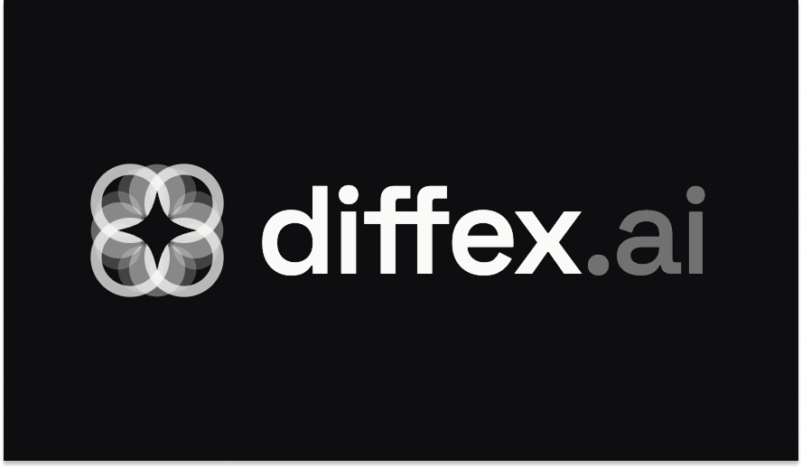

<p align="center">
  <a href="https://diffex.ai/">
    
  </a>
</p>

# Diffex

[](https://diffex.ai/)
[](rust-toolchain.toml)
[](LICENSE)
[](https://github.com/diffexai/diffex/actions/workflows/ci.yml)

Diffex treats the agent harness as an optimization target instead of a static configuration.
It records harness behavior, turns traces into diagnostic signals, proposes evidence-backed changes, and evaluates candidates before they replace the incumbent.

Read more about the product at [diffex.ai](https://diffex.ai/) and in the [Diffex white paper](https://diffex.ai/white-paper).

<p align="center">
  
</p>

## Workspace Crates

| Crate | Responsibility |
|-------|----------------|
| `contracts` | Shared passive types, identifiers, trace schemas, diagnostic records, proposal records, simulation records, and evaluation records. |
| `backend` | Backend-facing services, projection storage, facade contracts, fixtures, loopback routes, and trace projections. |
| `cloud-client` | Compatibility client for the stable Diffex Cloud session lifecycle API. |
| `session-store` | Durable local session journal, harness trace, and final context storage. |
| `harness-default` | Baseline harness boundary over `contracts` and `backend`. |
| `local-runtime` | Local harness runtime that wires backend facade services, provider configuration, trace projections, and `harness-default` for local workflows. |
| `evolution` | Deterministic diagnostic ranking, failure clustering, simulation replay, proposal generation, validation, and evaluation logic. |
| `tui` | Terminal client and `diffex` binary over `local-runtime` and backend-facing facade services. |

## Local Validation

```text
cargo fmt --all -- --check
cargo test --workspace --locked
cargo clippy --workspace --all-targets --locked -- -D warnings
cargo run -p tui
```

## Documentation

- [Architecture](docs/architecture.md)
- [Contributing](CONTRIBUTING.md)
- [Code of Conduct](CODE_OF_CONDUCT.md)
- [Deployment notes](docs/deployment.md)
- [Release smoke](docs/release-smoke.md)

## Contributing

Issues and pull requests are welcome.
Read [CONTRIBUTING.md](CONTRIBUTING.md) for local setup, validation, labels, and the pull request flow.

## Security

Do not commit secrets, local machine artifacts, build output, or generated private deployment state.
For sensitive reports, contact the maintainers through the repository or the contact paths on [diffex.ai](https://diffex.ai/).
